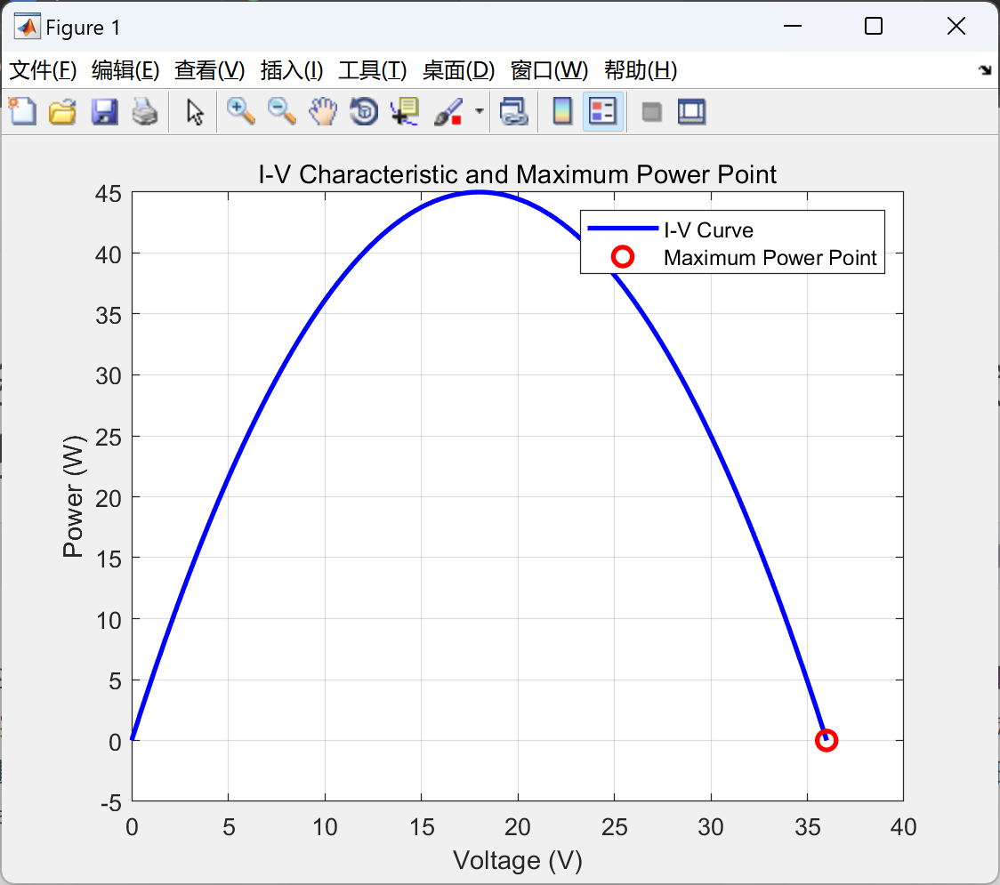

# Maximum Power Point Tracking (MPPT) of Solar Cells (Matlab Code Implementation)

The MATLAB code focuses on implementing the Incremental Derivative Method for Maximum Power Point Tracking (MPPT) algorithm to optimize the power output of solar cells. It takes into account key characteristics of solar cells, including open-circuit voltage (Voc), short-circuit current (Isc), and the number of series connected cells (Ns). The aim is to find the voltage at which the solar cell operates at its maximum power point.

The code starts with an initial guess for the MPPT voltage, followed by a perturbation step (delta) and a convergence tolerance. It then enters an iterative loop where the incremental derivative is calculated and the voltage is adjusted based on panel characteristics. The loop stops when the defined tolerance is reached.

As a result, the maximum power point voltage and corresponding maximum power are displayed in the command window. Additionally, the code plots the I-V curve of the solar cell and marks the maximum power point for visualization purposes.

## Images

<!-- PAYMENT_BLOCK -->

## Get this dataset

- Payment link (Stripe): [Buy now](https://buy.stripe.com/3cs8yP7sY87d0vu9AB)
- Payment QR code: 

<!-- /PAYMENT_BLOCK -->
